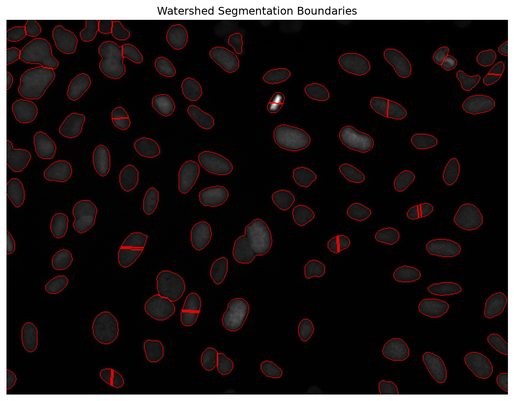
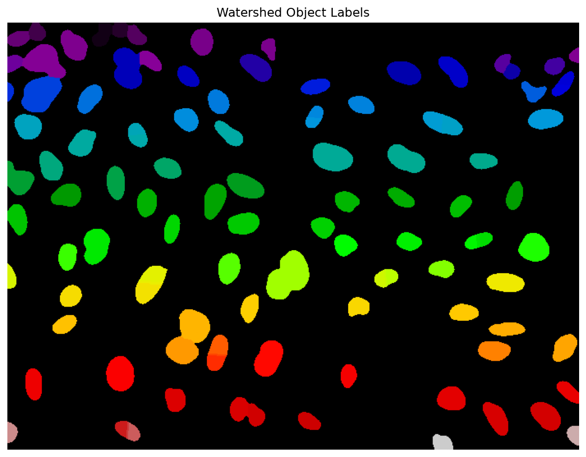

# Microscopy Image Analysis and Quantitative Characterization Pipeline

A modular Python application for processing fluorescence microscopy images, segmenting cellular structures, extracting quantitative features, and generating visual and statistical reports.

The project demonstrates the development of a reproducible scientific image-analysis workflow, combining image processing, quantitative analysis, visualization, and software engineering practices.

## Project Overview

Fluorescence microscopy produces images containing biological structures whose morphology and intensity can be studied quantitatively.

This project implements a Python-based workflow to:

- Load and preprocess microscopy TIFF images.
- Improve image quality through intensity normalization and Gaussian smoothing.
- Detect foreground structures using Otsu thresholding.
- Separate touching structures using watershed segmentation.
- Extract morphological and fluorescence-intensity measurements.
- Generate segmentation visualizations and statistical reports.
- Produce structured CSV outputs for further analysis.

The application is designed with modularity and reproducibility in mind, separating image processing, segmentation, feature extraction, evaluation, and reporting into independent Python modules.

## Dataset

The project uses images from:

**BBBC039 — Nuclei of U2OS Cells in a Chemical Screen**

Source: Broad Bioimage Benchmark Collection (BBBC).

Dataset characteristics:

- Fluorescence microscopy images.
- Hoechst-stained U2OS cell nuclei.
- Single-channel DNA fluorescence images.
- 16-bit TIFF format.
- Image dimensions: 520 × 696 pixels.
- The repository includes a selection of 30 images from the dataset.

The dataset provides a useful scientific imaging example for developing and testing image-processing workflows.

## Image Analysis Workflow

The processing pipeline follows these stages:

1. **Image loading:** Read microscopy images in TIFF format.
2. **Preprocessing:** Normalize intensity values and apply Gaussian smoothing to reduce noise.
3. **Thresholding:** Apply Otsu's method to identify foreground structures.
4. **Segmentation:** Use watershed segmentation to separate connected structures.
5. **Feature extraction:** Calculate morphological and intensity measurements for detected objects.
6. **Quality control:** Generate summary statistics describing the segmentation results.
7. **Visualization:** Save segmentation overlays and labelled object images.
8. **Reporting:** Generate statistical plots and CSV measurements.

## Methods and Technologies

### Image Processing
- Intensity normalization.
- Gaussian filtering.
- Otsu thresholding.
- Distance-transform-based watershed segmentation.

### Quantitative Feature Extraction

For each segmented object, the pipeline calculates:

| Feature | Description |
|---|---|
| Area | Number of pixels belonging to the object |
| Centroid | Object position in image coordinates |
| Eccentricity | Measure of object elongation |
| Solidity | Ratio describing object compactness |
| Mean intensity | Average image intensity within the object |

### Quality Control

The evaluation module generates basic segmentation summaries, including:

- Number of detected objects.
- Total foreground pixels.
- Mean object area.

These statistics provide an initial quality-control overview of the segmentation output.

## Project Structure

```text
Scientific-microscopy-image-analysis/
│
├── src/
│   └── image_analysis/
│       ├── preprocessing.py
│       ├── segmentation.py
│       ├── feature_extraction.py
│       ├── evaluation.py
│       ├── visualization.py
│       └── report.py
│
├── tests/
│   └── test_preprocessing.py
│
├── results/
│   ├── object_measurements.csv
│   ├── segmentation_overlay.png
│   ├── segmentation_labels.png
│   ├── area_distribution.png
│   ├── intensity_distribution.png
│   └── shape_distribution.png
│
├── main.py
├── requirements.txt
├── pyproject.toml
├── README.md
└── LICENSE
```

## Installation

Clone the repository:

```bash
git clone https://github.com/AmaniAppNest/Scientific-microscopy-image-analysis.git
cd Scientific-microscopy-image-analysis
```

Create and activate a virtual environment:

```bash
python -m venv .venv
```

On Linux or macOS:

```bash
source .venv/bin/activate
```

Install the dependencies:

```bash
pip install -r requirements.txt
```

Install the project in editable mode:

```bash
pip install -e .
```

## Running the Pipeline

Execute the main application:

```bash
python main.py
```

The current implementation processes the first TIFF image selected alphabetically from the repository root.

Generated outputs are saved in the `results/` directory.

## Output Examples

The pipeline generates several types of outputs:

**Segmentation overlay**

Shows the detected object boundaries over the original microscopy image.



**Labelled objects**

Displays the individual labels assigned to segmented regions.



**Quantitative measurements**

The `object_measurements.csv` file contains the extracted measurements for each detected object.

**Statistical reports**

The pipeline generates distributions for:

- Object area.
- Mean fluorescence intensity.
- Object shape characteristics.

## Testing

The project includes automated tests using pytest.

Run the test suite:

```bash
pytest -q
```

The current preprocessing test suite contains six tests covering image loading, missing-file handling, normalization, empty inputs, Gaussian smoothing, and invalid parameters.

## Software Architecture

The project follows a modular structure in which each component has a clearly defined responsibility.

- `preprocessing.py`: image loading, normalization, and smoothing.
- `segmentation.py`: threshold-based segmentation and watershed separation.
- `feature_extraction.py`: quantitative object measurements.
- `evaluation.py`: segmentation quality-control statistics.
- `visualization.py`: segmentation overlays and labelled images.
- `report.py`: statistical plots.
- `main.py`: integration and execution of the complete workflow.

This separation supports code reuse, maintainability, testing, and further development.

## Limitations and Future Development

The current implementation provides a foundation for quantitative microscopy image analysis.

Potential future improvements include:

- Evaluation against manually annotated ground-truth masks.
- Parameter optimization for different microscopy conditions.
- Processing multiple images in a single execution.
- Additional morphological and intensity measurements.
- More comprehensive segmentation quality metrics.

The detected regions should be interpreted as algorithmically segmented image objects rather than verified biological cell counts.

## License and Acknowledgements

The software is distributed under the MIT License.

The microscopy images originate from the BBBC039 dataset, provided by the Broad Bioimage Benchmark Collection under a CC0 licence.

Dataset: BBBC039 — Nuclei of U2OS Cells in a Chemical Screen.